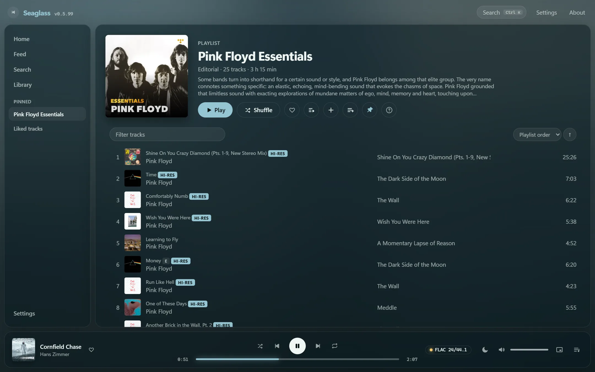
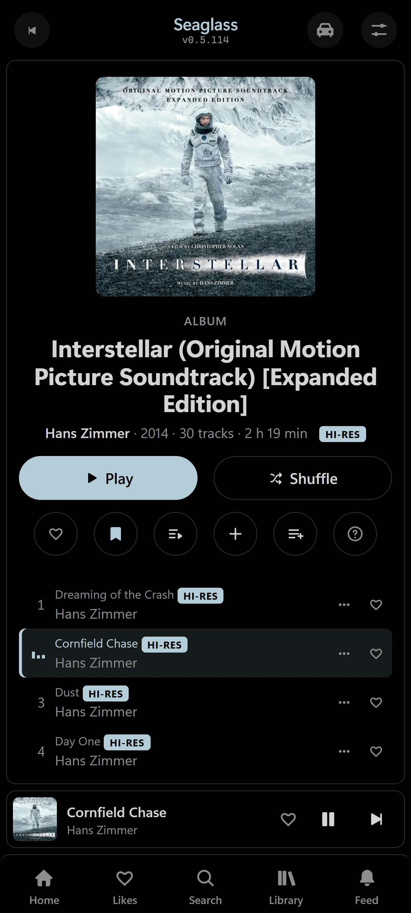
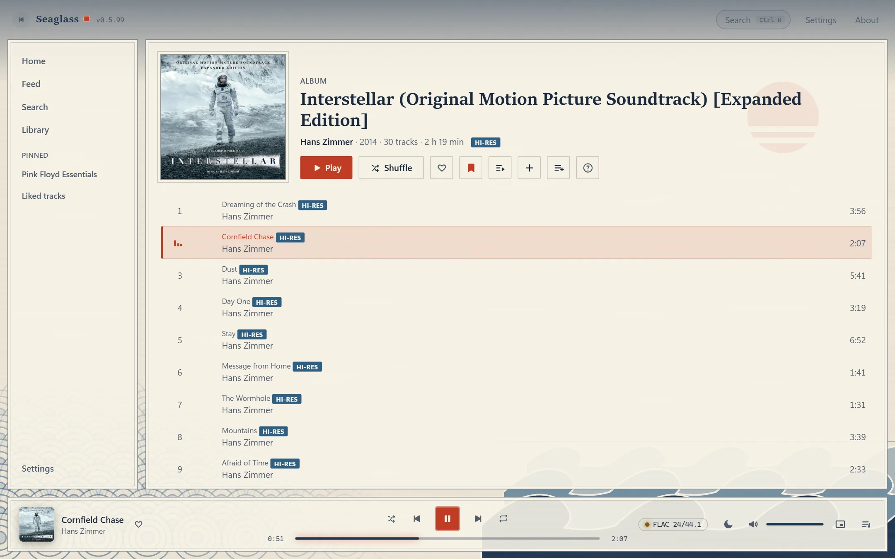
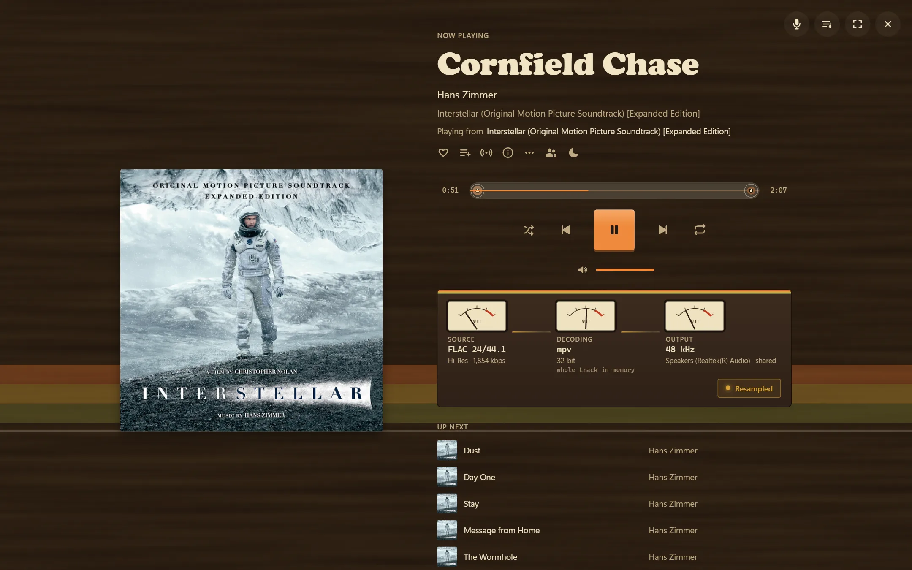

# Seaglass

[](https://seaglass.bebanana.ch/download)
[](https://github.com/BeBanana1/Seaglass/actions/workflows/ci.yml)
[](https://github.com/BeBanana1/Seaglass/releases/latest)
[](LICENSE)


Music streaming client for Windows, Android and Linux, with a fully custom interface and lossless / bit-perfect playback handed to [mpv](https://mpv.io) (desktop) or Media3 (Android). Website: **https://seaglass.bebanana.ch**.

> **Unofficial client, not affiliated with TIDAL.** A valid subscription is required. Streaming only: no audio stream is downloaded or written to disk, and DRM-protected streams are not played.

<p>
  
  
</p>
<p>
  
  
</p>

<sub>Seaglass, Midnight (Android), Estampe and Cassette: 4 of the 23 themes.</sub>

Current version: see [`VERSION`](VERSION); what's new in [`CHANGELOG.md`](CHANGELOG.md), also shown in the app (Settings › Application).

## Features

### Listening

- FLAC playback up to 24-bit / 192 kHz, with an album's hi-res edition when there is one. On Android, one quality for Wi-Fi and another for mobile data (Low, High in AAC, Lossless, Max), optionally lowered when the battery is low.
- Gapless playback: the next track is preloaded 30 s before the end.
- **WASAPI exclusive mode** on Windows: the audio output is reserved for Seaglass, with no mixing or resampling.
- **Parametric equalizer** (peaks, shelves, preamp), named profiles, AutoEQ profile import, response curve; on desktop, remembered for each audio output.
- Live signal path: format received, decoding, format sent to the output, how much of the track is already in memory.
- Audio output selection (per-output settings on desktop), volume normalization, pause when headphones are unplugged.
- Sleep timer, also at the end of an album, playlist or queue.
- Queue: original context, "Play next", "Add to queue", shuffle, repeat (all / one track), previous, save the queue as a playlist, "Undo" button after a removal.
- Queue, position and volume restored at startup, optional resume of playback on launch.
- Track radio, mixes, automatic radio at the end of the queue.
- **Playback handoff** between the computer and the Android app ("Resume here", "Continue on the computer"), over the local network or through the relay, end-to-end encrypted.
- Android, screen off: the audio chip decodes AAC when it can (offload), and the player puts little load on the CPU (measurements in "Compared with the official app").

### Catalog and library

- Personalized, reorderable home page, search as you type (tracks, albums, artists, playlists) with history, album, artist, playlist and mix pages.
- Library: playlists (with folders), albums, artists, liked tracks, mixes, "Save for later" and "Played in Seaglass".
- Playlists: create, rename, reorder, delete; clean up duplicates and tracks removed from the catalog.
- **Playlist import** from Spotify, Deezer or Apple Music by pasting its link, with a preview of the tracks found.
- Multi-select tracks to play them, queue them or add them to a playlist.
- Lyrics, clickable credits (a name opens the tracks that person is credited on), full-screen "Now playing" view.
- Optional notifications for new releases from followed artists.
- Hide explicit content or AI-generated music ("AI" badge otherwise).
- Pasted or tapped `tidal.com` links open directly in the app.
- Pins in the sidebar.
- Library export to JSON and CSV (desktop).

### Stats and discovery

- Listening stats over 7 days, 30 days, 12 months or the whole history, and a monthly and yearly recap.
- Smart playlists computed on the device: "My top 50 this month", "On repeat", "Forgotten favorites", "Liked, never played".
- Listening history synced between the computer and the linked Android app.
- Optional scrobbling to ListenBrainz, kept offline and sent later.
- **Blind test** from a playlist, mix, album or liked tracks: guess the title or artist from 15 s clips, alone or with the Jam guests.

### Jam

Guests add tracks to the queue from their phone, with no app or account: they scan a QR code and search in a web page. It works on the local network, or online through a relay (no shared Wi-Fi needed). The page accepts Spotify, Deezer, Apple Music and YouTube Music links. Guests can vote to skip a track, read the lyrics and, if the host allows it, change the volume or pause. The host stays in control: per-guest limits, albums allowed or not, additions paused, guests kicked.

### Interface

- About twenty themes, some with light and dark variants: **Seaglass** (frosted glass over the cover art, colors matched to the album), **Studio**, **Atelier**, **Midnight** (pure black, for OLED screens), **Acidwave**, **Surrealism**, **Solarpunk**, **Cyberpunk**, **Neumorphism**, **Terminal**, **Risograph**, **Bauhaus**, **Aero**, **Alloy**, **Estampe**, **Art Deco**, **Cassette**, **Showing**, **Ship Computer**, **Film Noir**, **Grand Hotel**, **Desert** and **Title Sequence**.
- Per-theme accent color, interface size (80 to 150 %, desktop), reduced or full animations.
- French and English, following the system language or chosen.
- Desktop: command palette (Ctrl+K) to go to a page, run an action or search, and shortcuts Space, Ctrl+,, Esc, Alt+←, F11, Ctrl+"+" / "-" / 0.
- Settings backup as text, to paste into Seaglass on another device.
- A few easter eggs on certain days, which can be turned off.

### System integration

- **Windows**: media keys and media flyout (SMTC), notification area icon, launch at sign-in, Discord presence.
- **Linux**: media controls through MPRIS (media keys, desktop applet, `playerctl`, KDE Connect), Discord presence.
- **Desktop**: optional global keyboard shortcuts, always-on-top mini player, **remote control** from a phone's browser on the same Wi-Fi.
- **Android**: media notification and session (headphones, car stereo, watch), home screen widget, pins as app icon shortcuts, full-screen driving mode with large tiles.
- Signed automatic updates on all three platforms.
- Logs and crash reports kept locally, copyable from Settings › Application.

## Compared with the official app

Comparison made on 2026-11-18. Figures come from measurements on a Galaxy S21 (#451, method and details in [`docs/android.md`](docs/android.md) › "Performance measurements"). For the official app, only what was verified is listed here, and it keeps evolving: some points may have changed since.

### On all platforms

**Better in Seaglass**

- Parametric equalizer, with AutoEQ profile import and a setting per audio output on desktop. The official app has no equalizer.
- Import of a Spotify, Deezer or Apple Music playlist by pasting its link, inside the app. The official app points to third-party services.
- Built-in ListenBrainz scrobbling and Discord presence. The official app needs third-party tools.
- About twenty themes, and the signal path shown down to the format sent to the output.

**Also in Seaglass**, with no verified comparison: the Jam (guests add tracks from their phone, with no app or account), the blind test alone or with others, the reorderable home page, stats and recap, smart playlists and duplicate cleanup, all computed on the device.

**Worse in Seaglass**

- No offline downloads: this is a project choice, it only streams.
- No Dolby Atmos and no videos. DRM-protected content is not played.
- No TIDAL Connect or Chromecast, and no iOS or macOS app.
- Unofficial client: it relies on a private API that can change without notice, and installs outside the app stores.

### Windows

- **On par**: WASAPI exclusive mode exists in both apps.
- **Better**: playback handed to mpv, with a detailed signal path (format received, decoding, format sent to the sound card).
- **Also in Seaglass**, with no verified comparison: remote control from the phone's browser, the mini player, global shortcuts and playback handoff with the Android app.
- **Worse**: the installer is not code-signed (SmartScreen asks for confirmation), and the bundled mpv requires an AVX2 CPU.
- Desktop performance has not been measured.

### Linux

- **Better**: the official app does not exist on Linux, only the web player is offered. Seaglass is a native app, with desktop media controls (MPRIS) and playback through mpv.
- **Worse**: no exclusive mode, and mpv must be installed from the system.

### Android

Measured on the S21, in % of one CPU core (lower = better):

| Scenario | Seaglass 0.5.90 | Official app 2.219.0 |
|---|---|---|
| Screen off, lossless playback (30 min) | **8.5 %** | 20.5 % |
| Screen off, High quality (AAC), Dolby Atmos off | **1.6 to 2.5 %** | not measured |
| "Now playing" open (5 min) | **9.8 %** | 81 % |
| Home page during playback | **5.7 %** | 12 % |
| Fast scrolling through a 489-track playlist | **42 %** (1.5 % janky frames) | 63 % (**0.2 %** janky frames) |
| Home page shown after a cold start | ~1.6 to 2 s | ~1.7 to 2.4 s |

Same playlist, in FLAC 16-bit / 44.1 kHz in both apps: Seaglass streamed it, the official app played its downloaded files. Phone connected over USB, so power use is estimated by Android, not measured on the battery.

- **Better**: less battery, screen off as well as on. A different quality on Wi-Fi and mobile data, optionally lowered when the battery is low. On mobile data, the audio chip decodes AAC (offload), if Dolby Atmos is turned off in the phone's settings.
- **Also in Seaglass**, with no verified comparison: driving mode with large tiles, the widget and pins as app icon shortcuts.
- **Worse**: no Android Auto (driving mode partly replaces it). In Max quality, 24-bit is reduced to 16-bit, and there is no bit-perfect output to a USB DAC. Scrolling is a little less smooth. The APK installs outside the Play Store.

## Installation

Versions published by the author can be downloaded from **https://seaglass.bebanana.ch/download**; to build and distribute your own, without that server, see "Building and self-hosting". After that, the app updates itself: when a new version is ready, it offers "Install and restart" or "Later".

- **Windows 10 / 11**: run the installer. It installs for the current user, without administrator rights, and mpv is included. The installer has no Windows code-signing certificate: SmartScreen asks for "More info" then "Run anyway". A CPU with AVX2 is required by the bundled mpv build.
- **Android** (arm64): install the APK, allowing unknown sources.
- **Linux** (x86_64): make the AppImage executable and run it. mpv comes from the system (`sudo apt install mpv`); tokens are stored in the keyring (Secret Service). Sign-in goes through the system browser: paste the redirect address shown into the app.

## Requirements (development)

- Windows 10 or 11 (with WebView2)
- [mpv](https://mpv.io/installation/) in `PATH` (used in debug builds), or its path in the `SEAGLASS_MPV_PATH` variable
- [Rust](https://rustup.rs) stable and the Visual Studio Build Tools (C++)
- [Node.js](https://nodejs.org) LTS and [pnpm](https://pnpm.io)

For Android (SDK, NDK, testing on a device) and Linux (build in WSL), see [`docs/android.md`](docs/android.md) and [`docs/linux.md`](docs/linux.md).

## Getting started

1. Create a `.env` file at the root (ignored by git, read at build time):

   ```
   TIDAL_CLIENT_ID=...
   TIDAL_CLIENT_SECRET=...
   ```

   Where to find these two values: see "TIDAL client identifiers" below. Addresses of the online services, optional: see "Building and self-hosting".

2. Install the dependencies and run the app in development:

   ```powershell
   pnpm install
   pnpm tauri dev
   ```

3. In the app, click **Sign in** and sign in in the window that opens.

### TIDAL client identifiers

TIDAL has no public API for third-party players, and Seaglass has no client identifier of its own. Like other unofficial clients, it signs in with the **PKCE client of TIDAL's Android app**, the only one that gets lossless DASH streams (an ordinary "device" client is capped at AAC 320 kbps, see [`docs/tidal.md`](docs/tidal.md)). The repository does not ship these values, on purpose:

- The Python library [`tidalapi`](https://github.com/tamland/python-tidal) carries them: `client_id_pkce` and `client_secret_pkce` of its `Config` class. The phase 0 spike (`spike/play.py login --pkce`) uses exactly those.
- Copy them into `.env` as `TIDAL_CLIENT_ID` and `TIDAL_CLIENT_SECRET`. They are built into your binary, so do not publish a build made with them unless you accept what follows.

What this means:

- These identifiers belong to TIDAL, not to this project. Using them from another app is not authorized by TIDAL: you do it under your own responsibility, and in principle it may go against TIDAL's terms of use.
- TIDAL can revoke or change them, or change the private API, at any time: sign-in or playback would then stop working until the code or the identifiers are updated.
- Seaglass never circumvents DRM: protected streams are refused, and nothing is downloaded or cached on disk.

## Development

```powershell
cd src-tauri; cargo fmt; cargo clippy --all-targets -- -D warnings; cargo test
pnpm check
pnpm test
```

Interface preview without Tauri, on mock data: `pnpm dev`, then `http://127.0.0.1:1420/?theme=studio&route=album` (see [`docs/interface.md`](docs/interface.md), "Preview without Tauri").

How to contribute (build, checks, commits, pull requests) is in [`CONTRIBUTING.md`](CONTRIBUTING.md), how to report a vulnerability in [`SECURITY.md`](SECURITY.md). Architecture, conventions and roadmap are described in [`CLAUDE.md`](CLAUDE.md), implementation notes per area in [`docs/`](docs/) and versions in [`CHANGELOG.md`](CHANGELOG.md). Bugs and requests are tracked in the [GitHub issues](https://github.com/BeBanana1/Seaglass/issues); each fix goes through an `issue-<n>-…` branch and a PR that closes the issue. The `relay/` folder holds the Jam relay (deployment in [`relay/README.md`](relay/README.md)), and `spike/` the phase 0 Python script that validated the stream formats.

## Building and self-hosting

Nothing depends on the author's server: no address or key is written in the code or scripts. They are read at build time, from the environment or from `.env` (full template: [`.env.example`](.env.example)). Without them, the app works without the matching service.

To provide yourself:

| What | Needed for | Where |
|---|---|---|
| `TIDAL_CLIENT_ID` / `TIDAL_CLIENT_SECRET` | signing in | `.env` (see [`docs/tidal.md`](docs/tidal.md)) |
| Updater key (`tauri signer generate -w ~/.tauri/seaglass.key`) | publishing desktop updates | outside the repository; the public key is built in from the `.pub` |
| `SEAGLASS_UPDATE_BASE_URL` + a public HTTPS folder | publishing versions | `.env`; `SEAGLASS_RELEASE_DEST` for uploading |
| Android keystore | publishing the APK | see [`docs/android.md`](docs/android.md) |
| `SEAGLASS_RELAY_BASE_URL` / `SEAGLASS_RELAY_KEY` + a relay | online Jam, playback handoff | `.env`, and [`relay/`](relay/README.md) |
| `DISCORD_CLIENT_ID` | Discord presence | `.env` |

```
# Relay for the online Jam and playback handoff (optional)
SEAGLASS_RELAY_BASE_URL=https://jam.example.org
SEAGLASS_RELAY_KEY=...
# Updates folder (optional; set by the release scripts)
SEAGLASS_UPDATE_BASE_URL=https://updates.example.org/seaglass
```

- **Relay**: anyone can host their own (folder [`relay/`](relay/README.md), same `SEAGLASS_RELAY_KEY` as the app). In the app, Settings › Application › Relay also lets you pick another one, with its key, or turn it off. Without a relay, the Jam still works on the local network (computer), and the "Jam" switch removes it from the app.
- **Updates**: the app only installs versions signed by the key whose public part is built in (`SEAGLASS_UPDATER_PUBKEY`, which the release scripts read from `<private key>.pub`; APK certificate on Android). To publish your own versions, you therefore need your own key, your own folder, and to build them into your build. Without an address or a key, the app offers no updates; with them, automatic checking can be turned off in Settings › Application.

## Publishing a version

1. Bump `VERSION` (and `src-tauri/Cargo.toml`), add the `CHANGELOG.md` entry, commit.
2. `pnpm release:all`: builds the Windows installer, the APK and the AppImage (in WSL), signed, with the update manifests, without publishing anything. `pnpm release` only builds the Windows installer.
3. `pnpm release:all -Publish`: publishes to the updates folder, adds the `v<version>` tag and creates the GitHub release.

Details, environment variables and keys in [`docs/release.md`](docs/release.md). The private signing keys (updater and APK) must be backed up: without them, installed versions will refuse every update.

## License

[GPL-3.0](LICENSE). mpv is launched as a separate program and driven over IPC, it is not linked with Seaglass's code; its license notice ships with the installer (`src-tauri/licenses/mpv.txt`).
